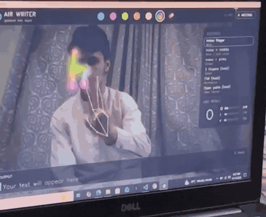
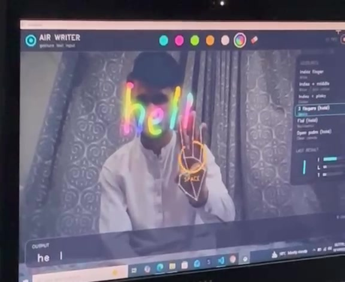

# Air Writer

Write in the air with your index finger in front of a webcam, and the app turns your strokes into text in real time. It can also type the recognised text into any app on your computer.



## How it works

```
webcam -> MediaPipe hand landmarks -> gesture logic -> glowing ink canvas
       -> CNN character recognition -> text output (+ optional typing into any app)
```

- **Hand tracking:** MediaPipe finds 21 hand landmarks per frame. The index fingertip is the pen.
- **Smooth strokes:** a One Euro filter removes jitter when the finger moves slowly, with little lag when it moves fast.
- **Recognition:** when you pause, the stroke is cropped, centred and resized to 28x28 (EMNIST style) and passed to a small CNN trained with PyTorch on **EMNIST balanced (47 classes: digits and letters)**. Very unsure predictions are rejected.
- **Typing mode:** with `--type`, each recognised character is also typed into the focused app using `pyautogui`.

## Gestures

| Gesture (palm facing the camera) | Action |
|---|---|
| Index finger only | Write |
| Index + middle | Move without drawing, or pick a colour / the eraser from the top bar |
| Index + pinky | Erase ink under the fingertip |
| 3 fingers (hold ~1 s) | Space |
| Fist (hold ~1 s) | Backspace |
| Open palm (hold ~1 s) | Clear all ink |

Keys: `ESC`/`q` quit · `Tab` side panel · `1`-`7` colours/eraser · `e` eraser · `c` clear canvas · `x` clear text · `s` save text to `output.txt`



## Setup

Use **Python 3.11** (MediaPipe 0.10.14 does not support the newest Python versions).

```
python -m venv venv
venv\Scripts\activate          (Windows)
pip install -r requirements.txt
```

### 1. Train the model

```
python train_model.py --epochs 8
```

This downloads EMNIST into `data/`, trains the CNN and saves the best model as `emnist_cnn.pt`. Training on a laptop CPU is slow, so I trained it on Google Colab with a free T4 GPU and copied `emnist_cnn.pt` next to `air_writer.py`.

### 2. Run the app

```
python air_writer.py                 # write in the air, text appears in the app
python air_writer.py --type          # also type the text into the focused app
python air_writer.py --camera 1      # use another webcam
python air_writer.py --fullscreen
```

## Project files

```
air_writer.py     the app: camera, hand tracking, gestures, drawing, recognition, UI
train_model.py    CNN model, EMNIST training script and label set
requirements.txt  dependencies
docs/             demo GIF and screenshot
```

## Tech

Python · OpenCV · MediaPipe · PyTorch · torchvision (EMNIST) · NumPy · pyautogui

## Author

**Muhammad Hashmi** · Swat, Pakistan · hashmi.freelance@gmail.com
